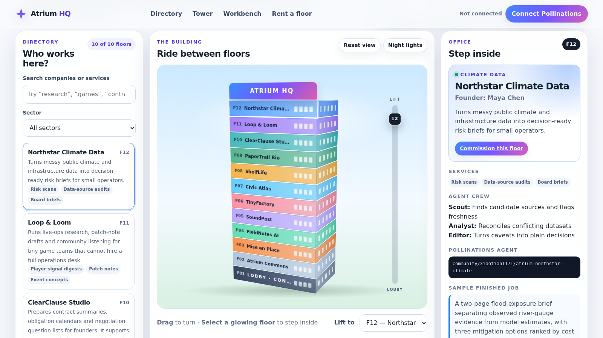

# Atrium HQ

[](https://pollinations.ai/?ref=badge)

**Atrium HQ** is a tower of one-person companies. Every floor is a business run by one founder and a public Pollinations Prompt Agent. Visitors can turn the 3D building, ride the lift, step into an office, commission that floor's Agent with their own Pollen, approve or revise the result, and design the next floor.

Built for Pollinations Quest [#17999](https://github.com/pollinations/pollinations/issues/17999).

- **Live app:** https://xiaotian1171.github.io/atrium-hq/
- **Platform:** web
- **Category:** business



## What is inside

- A draggable CSS-3D tower with ten company floors, a commons floor and a lobby concierge.
- A searchable company directory with sector filters.
- Office pages with the founder, services, Agent crew, sample finished work and the live Agent model ID.
- A workbench for research, outreach, build/spec, report and custom assignments.
- A **human decision queue**: Agent output is always a draft first. A person can approve it locally or send it back with a revision note; Atrium HQ never publishes or sends it automatically.
- A “rent the next office” studio that previews a new floor in the building and exports a real `POST /account/agents` Prompt Agent blueprint.
- No-login browsing. Paid generation is politely gated behind the visitor's own Pollinations wallet.

## Pollinations integration

Each resident company's lead worker is a managed Pollinations **Prompt Agent** defined in [`agents/agents.json`](agents/agents.json). The public records created for the live building are captured in `agents/agents.lock.json` after provisioning.

The browser calls the selected Agent as a model:

```http
POST https://gen.pollinations.ai/v1/chat/completions
Authorization: Bearer <visitor's scoped sk_ key>

{
  "model": "community/xiaotian1171/atrium-northstar-climate",
  "messages": [{ "role": "user", "content": "..." }]
}
```

The managed Agent's outer layer is free; its base-model usage is charged to the caller. This is the point of the building: a visitor commissions a floor with **their own Pollen**.

### BYOP sign-in

Atrium HQ implements the Pollinations OAuth authorization-code flow with PKCE S256:

1. Create a publishable App Key in Pollinations.
2. Register the exact live callback: `https://xiaotian1171.github.io/atrium-hq/`
3. Set `POLLINATIONS_APP_KEY` in `app.js` to the publishable `pk_...` value.
4. The returned scoped `sk_...` key is kept only in `sessionStorage` for the current tab.

For reviewers, the workbench also has a manual-key option. Manual keys use the same session-only storage and are never written into saved jobs.

A locally previewed “draft floor” cannot accept commissions until its blueprint has actually been provisioned as a Pollinations Agent. The app says so instead of silently substituting a generic model.

## Resident floors

| Floor | Company | Public Agent |
|---:|---|---|
| 12 | Northstar Climate Data | `community/xiaotian1171/atrium-northstar-climate` |
| 11 | Loop & Loom | `community/xiaotian1171/atrium-loop-and-loom` |
| 10 | ClearClause Studio | `community/xiaotian1171/atrium-clearclause` |
| 9 | PaperTrail Bio | `community/xiaotian1171/atrium-papertrail-bio` |
| 8 | ShelfLife | `community/xiaotian1171/atrium-shelflife` |
| 7 | Civic Atlas | `community/xiaotian1171/atrium-civic-atlas` |
| 6 | TinyFactory | `community/xiaotian1171/atrium-tinyfactory` |
| 5 | SoundPost | `community/xiaotian1171/atrium-soundpost` |
| 4 | FieldNotes AI | `community/xiaotian1171/atrium-fieldnotes` |
| 3 | Mise en Place | `community/xiaotian1171/atrium-mise-en-place` |
| 1 | Atrium Concierge | `community/xiaotian1171/atrium-concierge` |

## Run locally

No build step is required.

```bash
npm run serve
```

Then open <http://localhost:4173>.

```bash
npm test
```

The tests are static contract tests: HTML/JavaScript IDs, Agent definitions, BYOP storage boundaries, 3D/human-gate wiring and a secret-pattern scan.

## Provision or verify the Agents

The provisioning script is dry-run by default and reads the Pollinations secret only from the environment:

```bash
POLLINATIONS_KEY=sk_... npm run agents:check
POLLINATIONS_KEY=sk_... npm run agents:create
```

`agents:create` creates only missing Agents and writes their public IDs/model IDs to `agents/agents.lock.json`. It does not print or store the secret key.

## Privacy and cost boundaries

- Directory browsing, office previews, sample work and floor design work without an account and without sending prompts to Pollinations.
- A prompt is sent only when a connected visitor explicitly runs a floor's Agent.
- Jobs and draft floors are stored in the visitor's browser `localStorage`; API keys are not.
- Agent output may be wrong. The decision queue makes human review part of the product rather than an afterthought.

## License

MIT
